# OpenDeal

A self-hosted deal-flow CRM for small investment teams (angels, micro-VCs,
scout programs, studios). Track every company from first intro to pass or
investment, keep the whole team's notes, emails, and meetings on one page, and
share a read-only deal link with anyone, no login required.

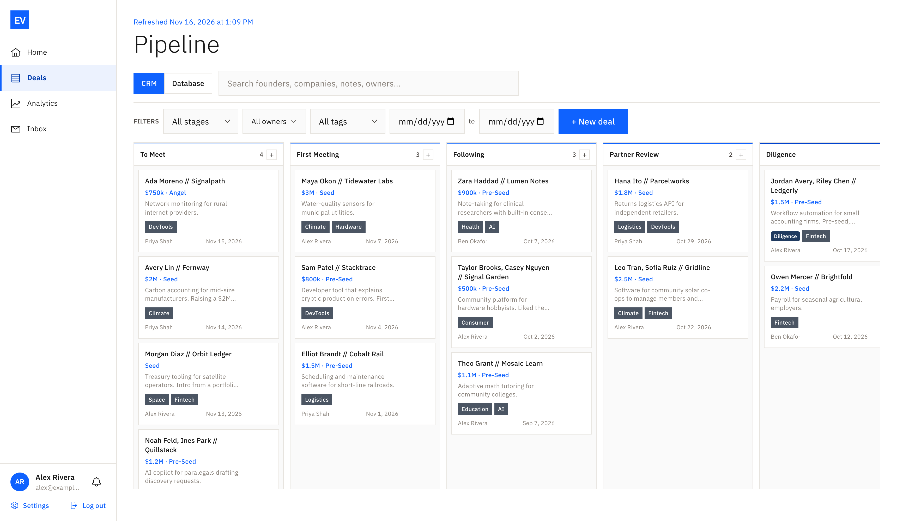

You own it: clone it, point it at your own Postgres database, deploy it to your
own Vercel account. There is no hosted service and no shared data.

## What you get

- **Pipeline board and table** with eight configurable stages, filters, bulk actions.
- **Deal cards**: founders, notes, comments, decisions and rationale, owners, attachments.
- **Share links**: `/deals/<id>` is a public read-only page with a link preview image.
- **Inbound queue** (optional): founders email pitches to a shared Gmail address;
  Claude reads the email and deck and drafts a deal for you to approve.
- **Meeting notes** (optional): Granola notes land in a triage inbox and attach to deals.
- **Calendar and email context** (optional): Google Calendar and Gmail show up on each deal.
- **Pass notes** (optional): draft a kind, specific decline email in your voice.
- **Analytics**: funnel, velocity, owner and tag breakdowns.
- **Team**: admin invites, roles, activity log, "view as" for admins.
- **Diligence export**: zip a deal's notes and files in one click.

Everything optional switches on only when you add its API key. A bare install
(database + sign-in) is a fully working CRM.

## Screenshots

**Pipeline table**

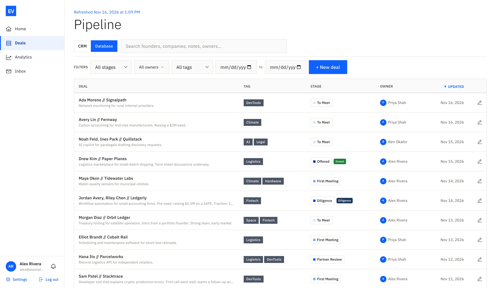

**Deal editor**

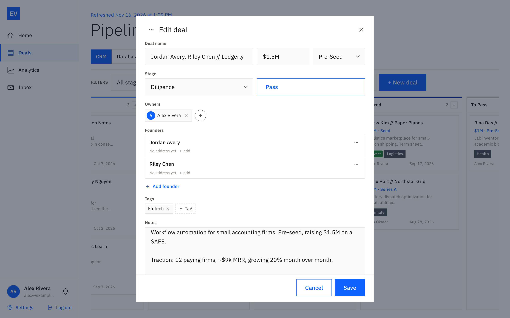

**Inbound inbox**

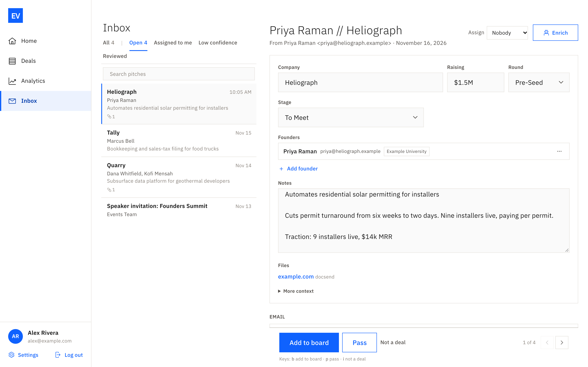

**Dashboard**

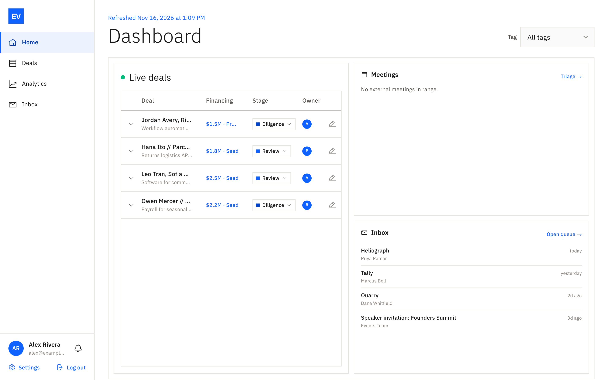

**Analytics**

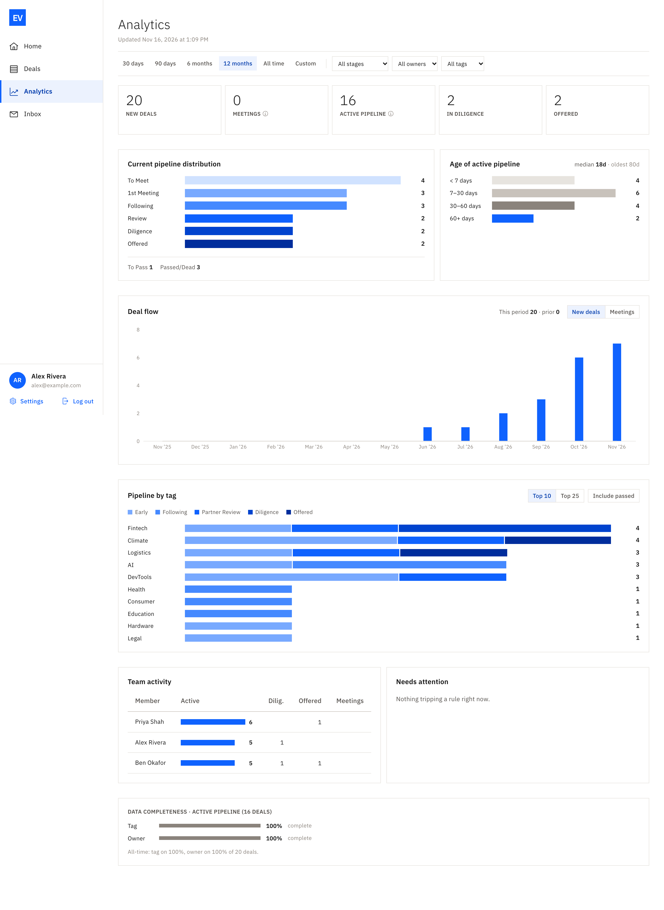

**Share links**

<p>
  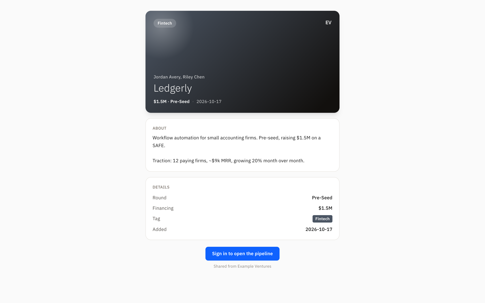
  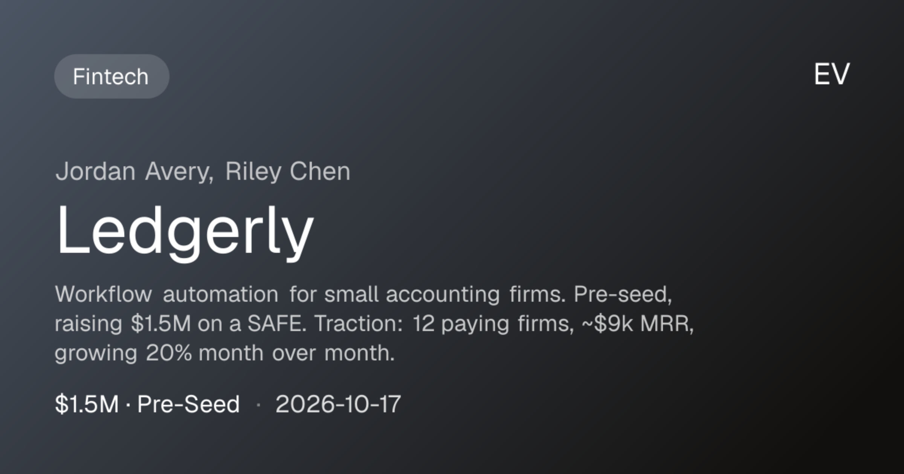
</p>

**Team**

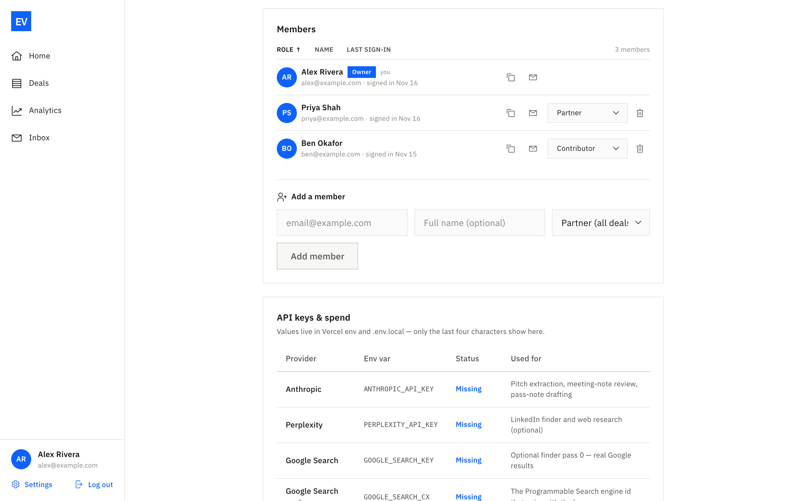

**Sign-in and mobile**

<p>
  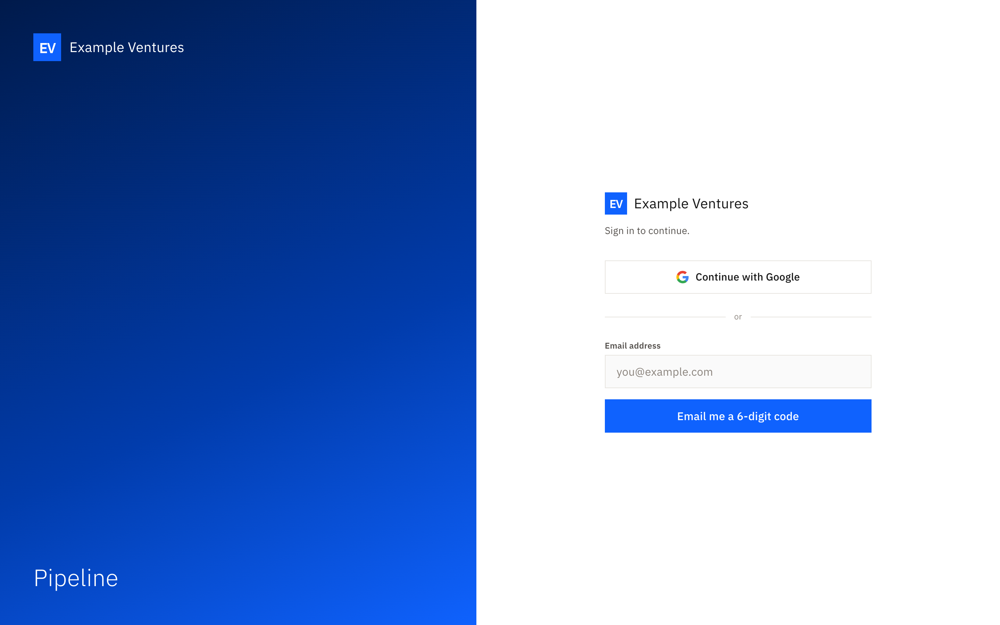
  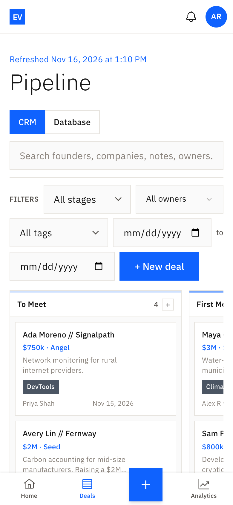
</p>

## Set it up with an AI agent (fastest)

Paste this into Claude Code, Codex, Cursor, or any coding agent that can run
commands on your computer:

```text
Set up OpenDeal for me. Read and follow
https://raw.githubusercontent.com/mallick-prat/OpenDeal/main/docs/AGENT_SETUP.md
Do every step you can yourself. When you need me for an account, a browser
click, or a key, tell me exactly what to do, one step at a time.
```

You need a free Vercel account. The agent does the rest.

## Quickstart (about 10 minutes, no accounts besides a database)

You need Node 20.9+ and a Postgres database. Easiest free option: a
[Supabase](https://supabase.com) or [Neon](https://neon.tech) project. Or use
local Postgres (`createdb opendeal`).

**Get your own copy**
Create a new repository** (name it anything, keep it private). That gives you
your own repo with a clean history. Then clone *your* copy:

```bash
git clone https://github.com/<your-username>/<your-repo>.git
cd <your-repo>
npm ci
cp .env.example .env.local
```

Edit `.env.local` and set at least:

```
DATABASE_URL=postgres://...            # your connection string
AUTH_SECRET=...                        # run: openssl rand -base64 32
FIRST_ADMIN_EMAIL=you@yourfund.com
FIRST_ADMIN_NAME=Your Name
NEXT_PUBLIC_ORG_NAME=Your Fund
NEXT_PUBLIC_TEAM_DOMAINS=yourfund.com
```

Then:

```bash
npm run db:setup -- --seed   # creates tables, your admin user, and fictional demo deals
npm run dev
```

Open http://localhost:3000, enter your `FIRST_ADMIN_EMAIL`, and click **Send
code**. In development the 6-digit code is printed in the terminal running
`npm run dev` (look for `[send-code]`), so you do not need email set up to try it.

When you are done exploring, delete the demo deals (open a deal, **Delete**).

## Deploy

[docs/SETUP.md](docs/SETUP.md) walks through production step by step: database,
Google sign-in, email, Vercel, and each optional integration.

## Make it yours

Name, team email domains, brand color, and timezone are environment variables.
Stage names and tag labels are one file: `src/config/crm.config.ts`. See
[docs/CONFIGURE.md](docs/CONFIGURE.md).

## Docs

- [docs/AGENT_SETUP.md](docs/AGENT_SETUP.md): the runbook an AI agent follows to set everything up
- [docs/SETUP.md](docs/SETUP.md): install, deploy, and integrations, step by step
- [docs/CONFIGURE.md](docs/CONFIGURE.md): branding, stages, tags
- [docs/INBOUND.md](docs/INBOUND.md): the inbound pitch mailbox
- [docs/ARCHITECTURE.md](docs/ARCHITECTURE.md): how it works, for contributors
- [CONTRIBUTING.md](CONTRIBUTING.md)

## Stack

Next.js 16 (App Router), React 19, Postgres (`postgres` driver), NextAuth v5,
Tailwind v4, Recharts, Vitest. AI features use the Anthropic API.

## License

MIT. See [LICENSE](LICENSE).
